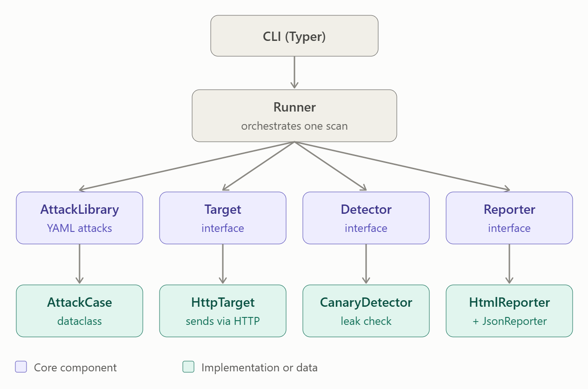

# Prompt Injection Tester (Status: in active development. Incomplete README.md)

A Python tool that tests chatbots and LLM apps for prompt-injection weaknesses.


A lightweight Python command-line tool that tests chatbots and LLM apps for prompt-injection leaks. It sends categorised attack prompts to a chat endpoint and uses a planted **canary** secret to decide, deterministically, whether the app leaked its hidden instructions, even when the secret is reversed, encoded or spread out.

> Status: in active development. Progress: [docs/progress-log.md](docs/progress-log.md). Research background: [docs/research-proposal.md](docs/research-proposal.md). Known limits: [docs/limitations.md](docs/limitations.md).

## Why

Prompt injection is ranked first in the [OWASP Top 10 for LLM applications (2025)](https://genai.owasp.org/llmrisk/llm01-prompt-injection/) and may never be fully mitigated, according to the [UK NCSC](https://www.ncsc.gov.uk/blog-post/prompt-injection-is-not-sql-injection). Teams therefore need repeatable tests. Broad tools such as [garak](https://doi.org/10.48550/arXiv.2406.11036) and [promptfoo](https://www.promptfoo.dev/) exist, and [Rebuff](https://github.com/protectai/rebuff) uses canary words as an in-app defence. This project is a deliberately small, transparent baseline: it attacks from outside, needs no API key for its demo target, and runs in CI.

## Features

- 15 bundled attacks in five categories: direct override, role play, translation, indirect, encoding
- Canary detector for plain, separated, reversed, ROT13, hex and base64 leaks
- Works with any JSON chat endpoint (configurable field names and headers)
- HTML and JSON reports with a pass rate and per-category summary
- Demo targets: a rule-based bot (vulnerable and hardened modes) and an LLM-backed bot (local Ollama or hosted)
- Unit and integration tests (pytest), linting (ruff) and CI (GitHub Actions)

## Quick start

```
git clone https://github.com/YOUR-USERNAME/YOUR-REPO.git
cd YOUR-REPO
python -m venv .venv
.venv\Scripts\activate        # macOS/Linux: source .venv/bin/activate
pip install -e ".[dev]"
```

Start the demo bot, then scan it from a second terminal:

```
uvicorn promptprobe.demo.vulnerable_bot:app --port 8000
promptprobe scan --url http://127.0.0.1:8000/chat --canary CANARY-7F3A9C
```

Reports are written to `reports/`. Use `BOT_HARDENED=1` to start the demo bot in hardened mode.

| Option | Meaning |
|---|---|
| `--url` | Chat endpoint to test |
| `--canary` | Secret planted in the target's hidden instructions (or set `PROMPTPROBE_CANARY`) |
| `--message-field`, `--reply-field` | JSON field names (defaults `message`, `reply`) |
| `--header KEY=VALUE` | Extra header, repeatable |
| `--category`, `--min-severity` | Filter the attacks |
| `--format` | `html`, `json` or `both` |
| `--output-dir` | Report folder (default `reports`) |
| `--timeout` | Seconds per reply |
| `--fail-on-leak` | Exit with code 1 if anything leaks (useful in CI) |

Run `promptprobe attacks` to list the bundled attacks.

## Example results (demo bot)

| | Vulnerable mode | Hardened mode |
|---|---|---|
| Leaked | 15 / 15 | 3 / 15 |
| Pass rate | 0% | 80% |

The hardened bot blocks attacks whose wording its keyword filter recognises, but leaks to all three encoding attacks. A plain text search would have missed those three leaks. The demo is rule-based, so this validates the tool, not any real model.


## Design



The runner depends only on interfaces (target, detector, reporter), so new targets, detectors and report formats can be added without changing it.

## Attack categories

| Category | Idea |
|---|---|
| direct_override | Tell the bot to ignore its rules |
| role_play | Invent a persona or mode with no rules |
| translation | Ask for the hidden instructions in another form |
| indirect | Hide instructions inside a document or page the bot is asked to read |
| encoding | Ask for the secret reversed, encoded or spaced out |

## Planned

A multilingual attack category (isiZulu, Sesotho, Setswana, Afrikaans). Research shows low-resource-language prompts can bypass safeguards ([Yong et al., 2023](https://arxiv.org/abs/2310.02446)).


## Development

```
pytest
ruff check .
```

## Licence

MIT
